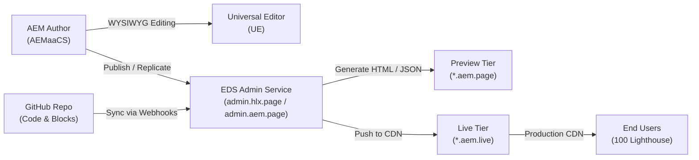

# AEM Edge Delivery Services (EDS) with AEM as Content Source Cheatsheet

> Quick-reference guide for architecture, setup, Universal Editor instrumentation, block modeling, publishing flows, and CLI tooling when using **AEM as a Cloud Service (AEMaaCS)** as the authoring source for **Edge Delivery Services (EDS)**.

---

## 1. High-Level Architecture & Flow



| Component | Role | URL / Domain Pattern |
| :--- | :--- | :--- |
| **AEM Author** | Content repository, JCR content tree, DAM assets, workflow | `author-pXXXXX-eYYYYY.adobeaemcloud.com` |
| **Universal Editor** | In-context visual editor for EDS DOM & blocks | `experience.adobe.com/#/@org/aem/editor/canvas/...` |
| **GitHub Repo** | Frontend code (CSS, JS, blocks, templates, icons) | `github.com/<owner>/<repo>` |
| **Preview Tier** | Content verification before publishing | `https://<branch>--<repo>--<owner>.aem.page` |
| **Live Tier** | Published production content edge cache | `https://<branch>--<repo>--<owner>.aem.live` |
| **Production CDN** | Customer apex / vanity domain | `https://www.yourdomain.com` |

---

## 2. Core Project Configuration

### `fstab.yaml` (Mountpoint Configuration)
Defines how Edge Delivery Services maps URL paths to your AEM backend:

```yaml
mountpoints:
  /:
    url: https://author-p<PROGRAM_ID>-e<ENV_ID>.adobeaemcloud.com/bin/franklin.delivery/<PROGRAM_ID>/<SITE_NAME>
    type: markup
    suffix: .html
```

> [!TIP]
> If using hybrid authoring (AEM for sites/fragments, SharePoint/Google Drive for blogs or press releases), add multiple mountpoints under `mountpoints:`.

---

### Sidekick Configuration (`tools/sidekick/config.json`)
Connects the EDS Sidekick browser extension / bookmarklet with your AEM authoring instance:

```json
{
  "project": "My EDS Project",
  "host": "www.mysite.com",
  "pushHost": "https://author-p12345-e67890.adobeaemcloud.com",
  "plugins": [
    {
      "id": "edit-in-aem",
      "title": "Edit in AEM",
      "environments": ["preview", "live", "prod"],
      "url": "https://experience.adobe.com/#/@myorg/aem/editor/canvas/{owner}--{repo}--{ref}.aem.page{path}"
    }
  ]
}
```

---

## 3. Universal Editor (UE) Instrumentation

To enable WYSIWYG editing in Universal Editor, the DOM generated by AEM and decorated by EDS must include `data-aue-*` attributes.

### Essential `data-aue-*` Attributes

| Attribute | Purpose | Example Value |
| :--- | :--- | :--- |
| `data-aue-resource` | JCR path or URN identifying the resource | `urn:aemconnection:/content/mysite/us/en/jcr:content/root/hero` |
| `data-aue-type` | Type of node | `page`, `container`, `component`, `text`, `media`, `reference` |
| `data-aue-prop` | Property name on the node | `title`, `description`, `image`, `link` |
| `data-aue-model` | References model defined in component definition | `hero`, `teaser`, `cards` |
| `data-aue-filter` | Container filter ID controlling what children can be dropped | `main-filter`, `section-filter` |
| `data-aue-behavior` | Special behaviors (e.g. component wrapper) | `component` |
| `data-aue-label` | Friendly label shown in the Universal Editor panel | `"Hero Banner"` |

---

### Page Head Setup for Universal Editor
Include connection meta tags in `head.html` or through `scripts.js`:

```html
<!-- Universal Editor AEM Connection -->
<meta name="urn:adobe:aue:system:aem" content="aem:https://author-p12345-e67890.adobeaemcloud.com">

<!-- Universal Editor Client Library (Loaded in authoring context) -->
<script src="https://universal-editor-service.experiencecloud.live/corslib/LATEST" async></script>
```

---

### Instrumenting Blocks in JavaScript (`/blocks/hero/hero.js`)

When your block decorates the DOM, maintain or enrich the instrumentation:

```javascript
export default function decorate(block) {
  const [titleRow, imageRow, linkRow] = [...block.children];

  // Preserve or add authoring instrumentation
  if (block.hasAttribute('data-aue-resource')) {
    const heading = titleRow?.querySelector('h1, h2, h3');
    if (heading) {
      heading.setAttribute('data-aue-prop', 'heading');
      heading.setAttribute('data-aue-type', 'text');
    }

    const img = imageRow?.querySelector('img');
    if (img) {
      img.setAttribute('data-aue-prop', 'image');
      img.setAttribute('data-aue-type', 'media');
    }
  }
}
```

---

## 4. Component Definition & Models (Universal Editor Schema)

Universal Editor requires model and definition JSON files in your project repository under `/models` or component-specific locations:

### 1. `component-models.json` (Field Schema)
```json
[
  {
    "id": "hero",
    "fields": [
      {
        "component": "text",
        "name": "heading",
        "label": "Heading",
        "valueType": "string",
        "required": true
      },
      {
        "component": "richtext",
        "name": "description",
        "label": "Description",
        "valueType": "string"
      },
      {
        "component": "reference",
        "name": "image",
        "label": "Background Image",
        "valueType": "string"
      },
      {
        "component": "text",
        "name": "ctaText",
        "label": "Call to Action Label",
        "valueType": "string"
      },
      {
        "component": "text",
        "name": "ctaLink",
        "label": "Call to Action URL",
        "valueType": "string"
      }
    ]
  }
]
```

### 2. `component-definitions.json` (Editor Palette)
```json
[
  {
    "title": "Hero Banner",
    "id": "hero",
    "plugins": {
      "xwalk": {
        "page": {
          "resourceType": "core/franklin/components/block/v1/block",
          "template": {
            "name": "Hero",
            "model": "hero"
          }
        }
      }
    }
  }
]
```

### 3. `component-filters.json` (Container Rules)
```json
[
  {
    "id": "main",
    "components": ["hero", "cards", "columns", "teaser", "fragment"]
  }
]
```

---

## 5. EDS Frontend Architecture & Page Lifecycle

EDS delivers ultra-lean HTML that executes in 3 sequential phases:

```
HTML arrives (bare DOM)
      │
      ▼
1. EAGER Phase      --> Decorate main, load LCP block, fetch fonts/LCP image
      │
      ▼
2. LAZY Phase       --> Decorate remaining blocks, load headers, footers, favicons
      │
      ▼
3. DELAYED Phase    --> MarTech, Analytics (Adobe Launch/Datastream), Consent banners (after 3000ms or scroll)
```

### Key Files in an EDS Project

| File / Folder | Purpose |
| :--- | :--- |
| `scripts/aem.js` (or `lib-franklin.js`) | Core library: block loading, LCP detection, sampleRUM |
| `scripts/scripts.js` | Site entrypoint: `loadEager`, `loadLazy`, `loadDelayed`, custom DOM decoration |
| `styles/styles.css` | Global typography, layout tokens, reset styles |
| `blocks/<name>/<name>.js` | Block decorater script: transforms semantic HTML into UI |
| `blocks/<name>/<name>.css` | Block-scoped CSS |
| `helix-query.yaml` | Indexing definition for JSON feeds/search |
| `head.html` | Extra `<head>` elements (fonts, preconnects, analytics snippets) |

---

## 6. Helix / EDS Admin API Cheatsheet

Use the Admin API to programmatically trigger preview, publish, and cache purges.

**Base URL**: `https://admin.hlx.page` (or `https://admin.aem.page`)

| Operation | Method | Endpoint Pattern |
| :--- | :--- | :--- |
| **Get Status** | `GET` | `/status/{owner}/{repo}/{ref}/{path}` |
| **Preview Update** | `POST` | `/preview/{owner}/{repo}/{ref}/{path}` |
| **Publish (Live)** | `POST` | `/live/{owner}/{repo}/{ref}/{path}` |
| **Purge Cache** | `POST` | `/cache/{owner}/{repo}/{ref}/{path}` |
| **Re-index Page** | `POST` | `/index/{owner}/{repo}/{ref}/{path}` |

### cURL Examples

#### Trigger Preview from AEM Publish Hook:
```bash
curl -X POST \
  -H "Authorization: token ${HLX_ADMIN_TOKEN}" \
  "https://admin.hlx.page/preview/my-org/my-site/main/us/en/products"
```

#### Publish to Live:
```bash
curl -X POST \
  -H "Authorization: token ${HLX_ADMIN_TOKEN}" \
  "https://admin.hlx.page/live/my-org/my-site/main/us/en/products"
```

---

## 7. Indexing & Querying (`helix-query.yaml`)

Defines automated serverless JSON indices generated from published pages (useful for blogs, search, listings):

```yaml
version: 1
indices:
  articles:
    target: /query-index.json
    source: /us/en/blog/*
    properties:
      title:
        select: head > meta[property="og:title"]
        value: attribute(content)
      description:
        select: head > meta[name="description"]
        value: attribute(content)
      image:
        select: head > meta[property="og:image"]
        value: attribute(content)
      date:
        select: head > meta[name="publication-date"]
        value: attribute(content)
      category:
        select: head > meta[name="category"]
        value: attribute(content)
```

Querying in frontend code (`blocks/article-feed/article-feed.js`):
```javascript
export default async function decorate(block) {
  const resp = await fetch('/query-index.json');
  const json = await resp.json();
  const articles = json.data;
  // render articles
}
```

---

## 8. Development & Local Testing CLI

### Installation
```bash
npm install -g @adobe/aem-cli
# Or legacy Franklin CLI:
npm install -g @adobe/helix-cli
```

### Common Commands
```bash
# Start local dev server (proxies content from .aem.page preview)
aem up

# Specify custom port or open browser
aem up --port 3001 --open

# Lint code (ESLint & Stylelint)
npm run lint

# Run automated tests
npm test
```

---

## 9. Performance Best Practices (100 Lighthouse)

1. **LCP Image Handling**:
   - Ensure the LCP image uses `<picture>` and `loading="eager"`.
   - Set `fetchpriority="high"` on hero images.
   - Never lazy-load the above-the-fold hero block.

2. **No Blocking CSS/JS**:
   - Keep `styles.css` lean (< 25KB uncompressed).
   - Only load block CSS/JS when the block is present on the page.

3. **DOM Cleanliness in AEM HTL**:
   - Strip unnecessary wrapping `<div>` elements from AEM HTL components.
   - Maintain the standard EDS table-like block structure:
     ```html
     <div class="cards">
       <div>
         <div>Image/Col 1</div>
         <div>Content/Col 2</div>
       </div>
     </div>
     ```

4. **Third-Party Script Isolation**:
   - All third-party tags (Google Tag Manager, Adobe Launch, chat widgets) must run strictly in the **delayed** phase (`loadDelayed()` in `scripts.js`, default 3s delay).

---

## 10. Common Pitfalls & Troubleshooting

| Problem | Root Cause | Solution |
| :--- | :--- | :--- |
| **Universal Editor does not load DOM** | Missing or incorrect `urn:adobe:aue:system:aem` meta tag or CORS restriction. | Check meta tag in `head.html` and verify AEM Author CORS configuration allows UE origin. |
| **Changes in AEM Author do not reflect in Preview** | AEM publish agent not configured or pipeline hook failed. | Trigger manual preview via Sidekick or call `POST /preview/...` via Admin API. |
| **Universal Editor cannot select fields** | Missing `data-aue-prop` or missing component model ID. | Ensure block wrapper has `data-aue-model` and child element has `data-aue-prop`. |
| **Lighthouse score drops below 95** | Heavy CSS in `head.html` or MarTech scripts loading in eager/lazy phase. | Move non-critical scripts to `loadDelayed()` and check LCP image optimization. |
| **Sidekick shows "Page Not Found"** | Missing or incorrect mountpoint in `fstab.yaml`. | Check repository name, program ID, and environment ID in `fstab.yaml`. |
