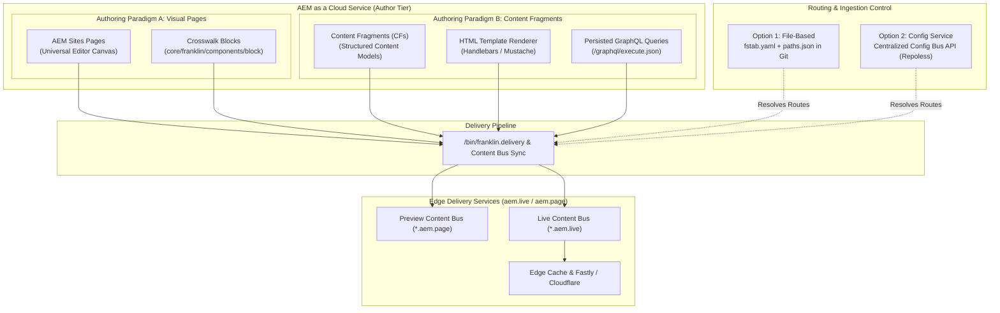
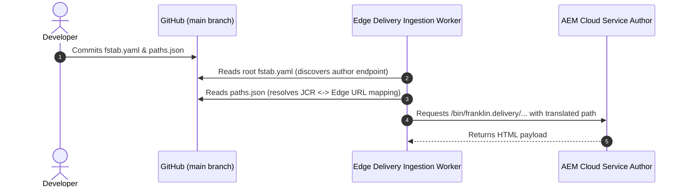
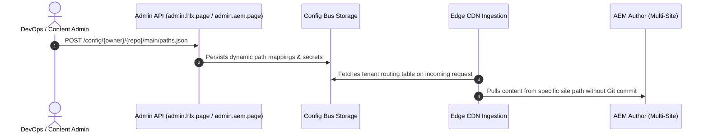
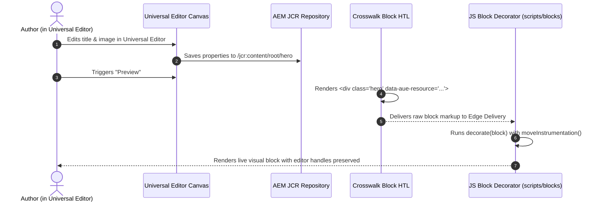
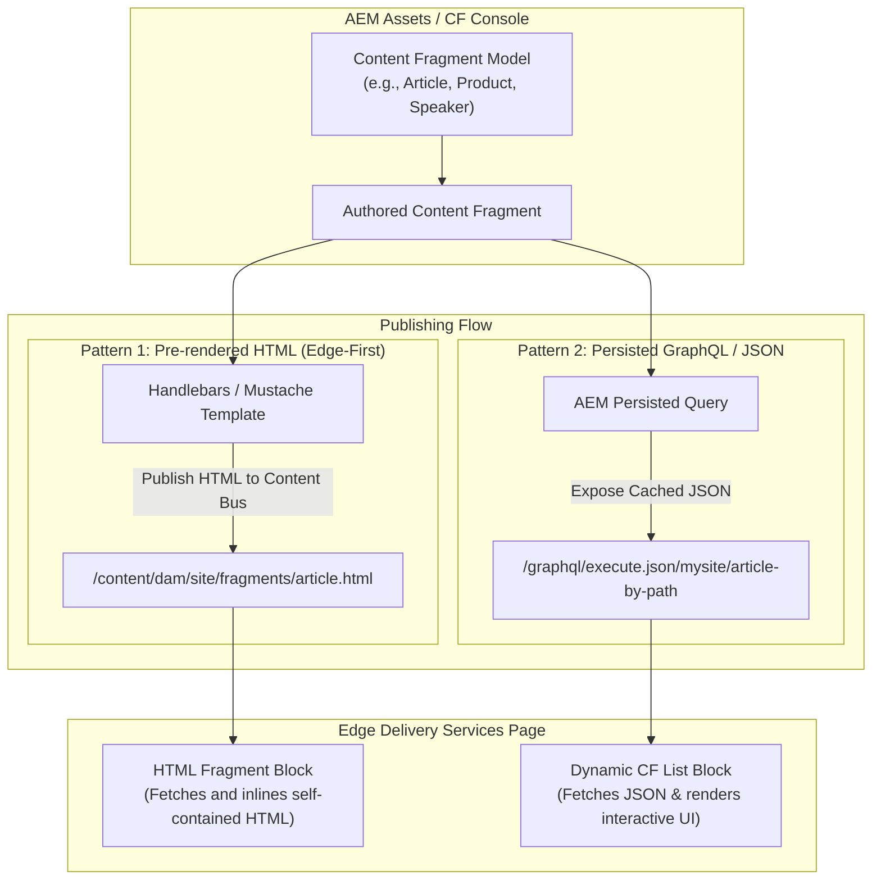

# AEM Edge Delivery Services (EDS) with AEM as a Content Source: Master Cheatsheet

> Complete, state-of-the-art reference covering **both** configuration methodologies (**File-Based** vs **Centralized Configuration Service**) and **both** authoring paradigms (**Crosswalk Visual Page Blocks** vs **Headless Content Fragments**), with end-to-end flow diagrams, production schemas, and code implementations.

---

## Master Architecture Overview



---

## Part 1: Configuration Approaches (File-Based vs Configuration Service)

### Comparison & Decision Matrix

| Dimension | Option 1: File-Based Configuration | Option 2: Centralized Configuration Service |
| :--- | :--- | :--- |
| **Primary Files** | `fstab.yaml`, `paths.json`, `helix-query.yaml` | Admin API `/config/...` endpoints, `config.json` |
| **Location** | Stored in GitHub repository (`main` branch) | Stored centrally in Edge Delivery **Config Bus** |
| **Multi-Site Capability** | 1 GitHub Repo = 1 Site Mount configuration | **Repoless**: 1 GitHub Repo serves 100+ multi-tenant/localized sites |
| **Deployment Mechanism** | Git commit + PR merge into `main` | Dynamic API call or Admin UI update (zero code deployments) |
| **Precedence** | Overrides Configuration Service if present in Git | Active when file-based configurations are absent from Git |
| **Recommended For** | Single-brand setups, developer-controlled repo configs | Enterprise multi-brand/multi-tenant setups, SaaS-style deployments |

---

### 1A. Option 1: File-Based Configuration (`fstab.yaml` + `paths.json`)

#### Flow Diagram: File-Based Resolution



#### 1. `fstab.yaml` (Repository Root)
Defines the mountpoint pointing to the AEM authoring service:

```yaml
mountpoints:
  /: https://author-p12345-e67890.adobeaemcloud.com/bin/franklin.delivery/my-org/my-site-repo/main
```

#### 2. `paths.json` (Repository Root)
Controls path rewriting, content inclusion, and exclusion rules:

```json
{
  "paths": {
    "mappings": [
      "/content/mysite/us/en/:/",
      "/content/mysite/uk/en-gb/:/uk/",
      "/content/mysite/de/de-de/:/de/",
      "/content/dam/mysite/:/assets/"
    ],
    "includes": [
      "/**"
    ],
    "excludes": [
      "/**/drafts/**",
      "/**/archive/**",
      "/**/internal-notes/**"
    ]
  }
}
```

---

### 1B. Option 2: Centralized Configuration Service (Repoless Setup)

In a repoless architecture, configuration is managed in the **Config Bus**. This allows multiple distinct AEM sites (e.g. `brand-a.com`, `brand-b.com`, `brand-c.de`) to share a single frontend GitHub repository (`adobe/enterprise-eds-theme`).

#### Flow Diagram: Centralized Config Service (Repoless)



#### Managing Path Mappings via Admin API

```bash
# Push path mappings dynamically to the Configuration Service
curl -X POST \
  -H "Authorization: token ${HLX_ADMIN_TOKEN}" \
  -H "Content-Type: application/json" \
  --data '{
    "mappings": [
      "/content/brand-a/us/en/:/",
      "/content/brand-b/us/en/:/brand-b/",
      "/content/dam/enterprise/:/assets/"
    ],
    "excludes": [
      "/**/drafts/**"
    ]
  }' \
  "https://admin.hlx.page/config/my-org/my-shared-repo/main/paths.json"
```

#### Managing Access & HTTP Headers via Admin API

```bash
# Set custom HTTP headers (CORS, caching, CSP) dynamically
curl -X POST \
  -H "Authorization: token ${HLX_ADMIN_TOKEN}" \
  -H "Content-Type: application/json" \
  --data '{
    "/**": {
      "headers": {
        "Strict-Transport-Security": "max-age=31536000; includeSubDomains",
        "X-Frame-Options": "SAMEORIGIN",
        "Access-Control-Allow-Origin": "*"
      }
    }
  }' \
  "https://admin.hlx.page/config/my-org/my-shared-repo/main/headers.json"
```

> [!CAUTION]
> **Precedence Warning**: If a physical `paths.json` exists in your repository root, Edge Delivery will ignore the Configuration Service API. To migrate to the Configuration Service, delete `paths.json` from Git.

---

## Part 2: Authoring Paradigms (Crosswalk Page Blocks vs Content Fragments)

### Comparison & Decision Matrix

| Dimension | Paradigm A: Crosswalk Visual Blocks | Paradigm B: Content Fragments (CFs) |
| :--- | :--- | :--- |
| **Primary Persona** | Visual Content Authors, Marketers | Structured Data Authors, Copywriters, DAM Managers |
| **Authoring Tool** | **Universal Editor (WYSIWYG)** Canvas | **Content Fragment Console** / Spreadsheet feeds |
| **Underlying Resource** | `core/franklin/components/block/v1/block` | `dam:Asset` with `cq:model` (Content Fragment Model) |
| **DOM Delivery** | Rendered as table-like `div` containers | Rendered via **HTML Handlebars Template** or JSON feed |
| **Best Used For** | Marketing pages, Landing pages, Custom layout grids | Products, Press releases, Team bios, Omnichannel feeds |
| **LLM & SEO Crawl** | Standard page HTML markup | Pre-rendered semantic HTML or clean JSON feeds |

---

### 2A. Paradigm A: Crosswalk Visual Page Blocks

Crosswalk page blocks are standard AEM components placed on an AEM page that output the table-like DOM structure expected by Edge Delivery Services, instrumented with `data-aue-*` for the Universal Editor.

#### Flow Diagram: Crosswalk Block Execution



#### 1. AEM HTL Component Structure (`/apps/mysite/components/hero/hero.html`)
The HTL component outputs the strict EDS table contract:

```html
<div class="hero" 
     data-aue-resource="urn:aemconnection:${resource.path}" 
     data-aue-type="component" 
     data-aue-model="hero" 
     data-aue-label="Hero Banner">
  <div>
    <div data-aue-prop="image" data-aue-type="media">
      <sly data-sly-test="${properties.fileReference}">
        
      </sly>
    </div>
  </div>
  <div>
    <div>
      <h1 data-aue-prop="headline" data-aue-type="text">${properties.headline}</h1>
      <div data-aue-prop="description" data-aue-type="richtext">
        ${properties.description @ context='html'}
      </div>
      <p data-aue-prop="ctaUrl" data-aue-type="reference">
        <a href="${properties.ctaUrl}" class="button primary">${properties.ctaLabel}</a>
      </p>
    </div>
  </div>
</div>
```

#### 2. Universal Editor Model (`component-models.json`)
```json
[
  {
    "id": "hero",
    "fields": [
      {
        "component": "text-input",
        "name": "headline",
        "label": "Headline",
        "valueType": "string",
        "required": true
      },
      {
        "component": "richtext",
        "name": "description",
        "label": "Description",
        "valueType": "string"
      },
      {
        "component": "reference",
        "name": "image",
        "label": "Background Image",
        "valueType": "string"
      },
      {
        "component": "text-input",
        "name": "altText",
        "label": "Image Alt Text",
        "valueType": "string"
      },
      {
        "component": "text-input",
        "name": "ctaLabel",
        "label": "Button Label",
        "valueType": "string"
      },
      {
        "component": "reference",
        "name": "ctaUrl",
        "label": "Button Link URL",
        "valueType": "string"
      }
    ]
  }
]
```

#### 3. Frontend Block Decorator (`blocks/hero/hero.js`)
Uses `moveInstrumentation()` to maintain Universal Editor handles when altering DOM:

```javascript
import { moveInstrumentation } from '../../scripts/scripts.js';

export default function decorate(block) {
  const [imageCol, contentCol] = [...block.children];

  // Restructure image into background picture wrapper
  if (imageCol) {
    const imgWrapper = document.createElement('div');
    imgWrapper.className = 'hero-image-wrapper';
    moveInstrumentation(imageCol, imgWrapper);

    const img = imageCol.querySelector('img');
    if (img) {
      img.setAttribute('loading', 'eager');
      img.setAttribute('fetchpriority', 'high');
      imgWrapper.append(img);
    }
    imageCol.replaceWith(imgWrapper);
  }

  // Restructure content column
  if (contentCol) {
    const contentWrapper = document.createElement('div');
    contentWrapper.className = 'hero-content-wrapper';
    moveInstrumentation(contentCol, contentWrapper);

    while (contentCol.firstElementChild) {
      contentWrapper.append(contentCol.firstElementChild);
    }
    contentCol.replaceWith(contentWrapper);
  }
}
```

---

### 2B. Paradigm B: AEM Content Fragments (CFs) as a Content Source

There are two primary patterns to serve AEM Content Fragments through Edge Delivery Services:
1. **HTML-Rendered Content Fragments (Modern Edge-First & SEO Pattern)**: AEM automatically transforms the Content Fragment into self-contained semantic HTML using an assigned Handlebars/Mustache template before publishing to the Content Bus.
2. **GraphQL / JSON Exporter Pattern**: AEM exposes persisted GraphQL endpoints or JSON files cached on the Edge, which an EDS block queries and renders on the client side.

#### Flow Diagram: Content Fragment Ingestion & Rendering



---

#### Pattern B1: HTML Template-Transformed Content Fragments (Modern SEO / Edge First)

AEM Cloud Service allows assigning an HTML template (written in Handlebars) to a Content Fragment Model. When published, it writes a pre-rendered, crawlable HTML file to the edge.

##### 1. Handlebars Template Assigned in AEM (`article-fragment.hbs`):
```handlebars
<div class="article-fragment" data-aue-resource="urn:aemconnection:{{_path}}" data-aue-type="component" data-aue-model="article-cf">
  <div class="article-header">
    <h1 data-aue-prop="title" data-aue-type="text">{{title}}</h1>
    <p class="article-meta">
      <span class="author" data-aue-prop="author" data-aue-type="text">{{author}}</span> | 
      <time datetime="{{publishDate}}">{{publishDate}}</time>
    </p>
  </div>
  {{#if heroImage}}
    <div class="article-hero" data-aue-prop="heroImage" data-aue-type="media">
      
    </div>
  {{/if}}
  <div class="article-body" data-aue-prop="articleBody" data-aue-type="richtext">
    {{{articleBody.html}}}
  </div>
</div>
```

##### 2. EDS Block to Inject HTML Fragments (`blocks/fragment/fragment.js`):
```javascript
export default async function decorate(block) {
  const link = block.querySelector('a');
  const path = link ? link.getAttribute('href') : block.textContent.trim();

  if (!path) return;

  try {
    const resp = await fetch(`${path}.plain.html`);
    if (!resp.ok) throw new Error(`Failed to fetch fragment from ${path}`);

    const html = await resp.text();
    const parser = new DOMParser();
    const doc = parser.parseFromString(html, 'text/html');

    // Replace the block wrapper with the loaded fragment content
    block.innerHTML = '';
    block.append(...doc.body.children);
  } catch (err) {
    // eslint-disable-next-line no-console
    console.error('Fragment loading error:', err);
    block.innerHTML = '<p class="fragment-error">Unable to display fragment.</p>';
  }
}
```

---

#### Pattern B2: Client-side Rendered Content Fragments via GraphQL

Used when you need dynamic filtering, client-side pagination, or search against a library of Content Fragments.

##### 1. Persisted Query in AEM (`mysite/get-articles`):
```graphql
query getArticles($limit: Int) {
  articleList(_filter: { _path: { _expressions: [{ value: "/content/dam/mysite/articles" }] } }, _limit: $limit) {
    items {
      _path
      title
      author
      publishDate
      heroImage {
        ... on ImageRef {
          _path
        }
      }
      summary {
        plaintext
      }
    }
  }
}
```

##### 2. EDS Block Consuming GraphQL Query (`blocks/cf-feed/cf-feed.js`):
```javascript
export default async function decorate(block) {
  const endpoint = 'https://publish-p12345-e67890.adobeaemcloud.com/graphql/execute.json/mysite/get-articles;limit=10';

  block.innerHTML = '<div class="loading-state">Loading articles...</div>';

  try {
    const resp = await fetch(endpoint);
    const json = await resp.json();
    const articles = json?.data?.articleList?.items || [];

    const container = document.createElement('div');
    container.className = 'cf-feed-grid';

    articles.forEach((item) => {
      const card = document.createElement('article');
      card.className = 'cf-feed-card';
      card.innerHTML = `
        ${item.heroImage ? `` : ''}
        <h3>${item.title}</h3>
        <p class="author">By ${item.author}</p>
        <p class="summary">${item.summary?.plaintext || ''}</p>
      `;
      container.append(card);
    });

    block.innerHTML = '';
    block.append(container);
  } catch (e) {
    block.innerHTML = '<p>Error loading articles.</p>';
  }
}
```

---

## Part 3: Universal Editor Backend Connectivity Setup

Regardless of whether you author Visual Blocks or Content Fragments, AEM Cloud Service requires OSGi and CORS configuration to accept Universal Editor connections.

### OSGi CORS Factory (`ui.config` Module)
File location: `/ui.config/src/main/content/jcr_root/apps/mysite/osgiconfig/config.author/com.adobe.granite.cors.impl.CORSPolicyImpl~universaleditor.cfg.json`

```json
{
  "supportscredentials": true,
  "supportedmethods": [
    "GET",
    "HEAD",
    "POST",
    "PUT",
    "DELETE",
    "OPTIONS"
  ],
  "supportedheaders": [
    "Origin",
    "Accept",
    "X-Requested-With",
    "Content-Type",
    "Access-Control-Request-Method",
    "Access-Control-Request-Headers",
    "Authorization"
  ],
  "alloworigin": [
    "https://experience.adobe.com"
  ],
  "allowedpaths": [
    "/content/.*",
    "/graphql/execute.json.*"
  ]
}
```

### Frontend Head Connections (`head.html`)
```html
<!-- Universal Editor Client Library -->
<script src="https://universal-editor-service.adobe.io/cors.js" async></script>

<!-- Connection Mappings -->
<meta name="urn:adobe:aue:system:aemconnection" content="aem:https://author-p12345-e67890.adobeaemcloud.com">
<meta name="urn:adobe:aue:config:service" content="https://universal-editor-service.adobe.io">
```

---

## Part 4: Testing & Verification Matrix

| Verification Step | Command / Test | Expected Result |
| :--- | :--- | :--- |
| **Verify Mountpoint** | Run `aem up` locally and load `http://localhost:3000/us/en/` | Loads HTML synced directly from AEM Author servlet. |
| **Verify CORS** | Open Network tab in Universal Editor on `experience.adobe.com` | `OPTIONS` and `PATCH` requests to AEM Author return `Access-Control-Allow-Origin: https://experience.adobe.com`. |
| **Verify DOM Handles** | Hover over blocks in Universal Editor | Blue bounding outline wraps the block without broken or displaced overlays. |
| **Verify Pre-Rendered CFs**| Fetch `https://main--repo--org.aem.page/content/dam/site/fragments/article.plain.html` | Returns clean semantic HTML rendered from the Handlebars template. |
| **Verify Performance** | Run Google PageSpeed Insights on `*.aem.live` URL | 100/100 Mobile and Desktop score with LCP < 1.2s. |
